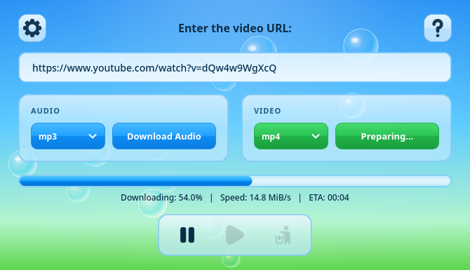
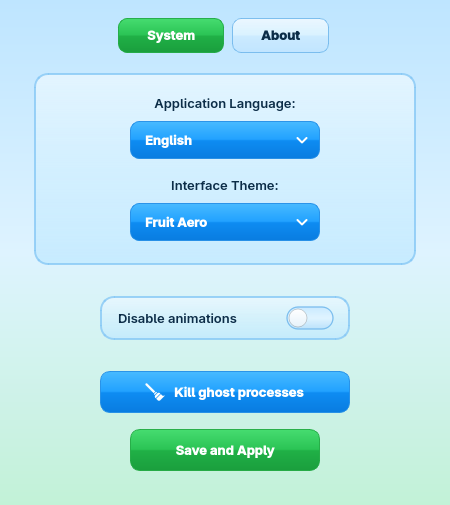
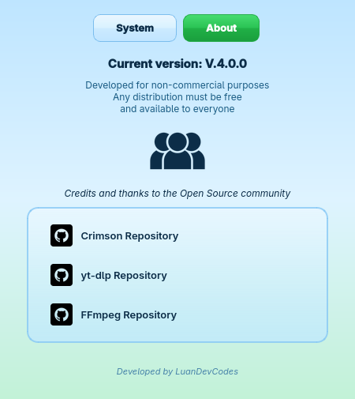
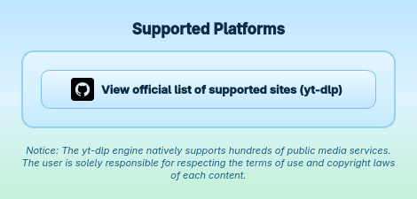

<h1 align="center">
   
  Project Crimson - Cross-Platform Media Archiving Client
</h1>

<p align="center">
  <a href="LICENSE"></a>
  
  
  
  
  
</p>

<p align="center">
  <sub>English &nbsp;|&nbsp; <a href="README_Translates/README_portuguese.md">Português (Brasil)</a></sub>
</p>

## = Project Description
Crimson is a cross-platform desktop application developed in Python with modern graphical rendering (PySide6 / Qt6), engineered to simplify and automate local media archiving and audio/video stream extraction across multiple desktop environments. The project brings together the extraction engine of `yt-dlp` and the multimedia processing pipeline of `FFmpeg` behind an elegant, responsive, and hardware-efficient graphical interface with native vector anti-aliasing on both Windows and Linux. 

The software autonomously manages its underlying extraction engine, performing automated integrity checks and updates to maintain compatibility with modern streaming protocols and format standards. Created as an open-source educational utility, Crimson provides the community with a safe, accessible, and lightweight desktop alternative for offline media backup and educational content preservation.

## Δ Libraries & Core Technologies
- **Python 3.x**
- **yt-dlp**: Core extraction engine handling raw multimedia streams.
- **PySide6 (Qt6)**: Graphical user interface powered by Qt 6 with native anti-aliasing, uniform cross-platform styling (Fusion), modular action cards, and dynamic theme rendering.
- **Threading**: Asynchronous task scheduling ensuring a zero-freeze experience, decoupling heavy download pipelines from the graphical event loop.
- **json & os & platform**: Native system persistence adapting user configuration paths per platform (`%LOCALAPPDATA%` on Windows, XDG on Linux).
- **urllib.request & zipfile**: In-memory modular updater with streaming chunking and network protection timeouts.
- **subprocess & re**: Native process supervision (terminating orphaned background tasks) and precompiled regex cleaning for progress parsing.
- **webbrowser**: Standard redirection module for repository and credits navigation.
- **Pillow (PIL)**: High-definition RGBA color processing with in-memory RAM caching for instant response.

## § Features
- **Flexible Stream Extraction**: Seamless separation and extraction of audio and video with format multiplexing (`mp3`, `mp4`, `mkv`, `webm`, etc.) via visual dropdown menus.
- **Asynchronous Architecture (Zero-Freeze)**: Network and disk operations execute on secondary threads, communicating progress, transfer speed, and ETA to the main UI thread via Qt Signals and Slots without stuttering.
- **Chunked Network Division**: Streams are split into manageable chunks (`http_chunk_size`) utilizing concurrent connection pools to maximize transfer stability.
- **Protected Auto-Updater**: On startup, Crimson verifies and fetches updates for the extraction engine with automated ZIP integrity checks, path traversal safeguards, and a 5-second timeout for offline or low-connectivity environments.
- **Direct Stream Multiplexing (FFmpeg)**: Video and audio channels are merged without re-encoding overhead whenever possible, preserving CPU cycles and completing conversions in seconds.
- **Real-Time Internationalization (25 Native Languages)**: Full native support for 25 languages sorted alphabetically, including Arabic, Bambara, Bengali, Chinese, Dutch, English, Filipino, French, German, Hausa, Hindi, Indonesian, Italian, Japanese, Korean, Latin, Norwegian, Persian, Polish, Portuguese, Russian, Spanish, Turkish, Ukrainian, and Vietnamese. Languages can be switched on the fly without restarting.
- **Visual Identity & 6 Dynamic Themes**: Curated aesthetic options including the signature **Frutiger Aero** (featuring animated bubbles, sky gradients, and glossy Aqua glassmorphism), **Dark**, **Egg**, **Matcha**, **Savage**, and **Platinum Disc**, with a built-in animation toggle switch for zero-CPU static mode.
- **Hardware Optimization for Low-End PCs**:
  - *In-Memory Icon Cache*: Image assets are read from disk only once; subsequent lookups take microseconds directly from RAM.
  - *Progress Throttling (~16 FPS / 60ms)*: Eliminates ~85% of redundant UI repaint overhead during high-speed downloads.
  - *Active Garbage Collection*: Explicit memory reclamation (`gc.collect`) when pausing, canceling, or completing transfers.
  - *Precompiled Regex*: Regular expressions compiled at launch to conserve CPU cycles per iteration.
- **Cross-Platform Path Resolution**: User preferences persist in standard system locations (`~/.local/share/Crimson` on Linux, `%LOCALAPPDATA%\Crimson` on Windows). Downloaded files are routed to the user's native OS Downloads folder.
- **Centered Window Logic**: Window coordinates are calculated against the active primary display geometry, ensuring proper centering across multi-monitor setups.
- **Process Cleanup Utility**: Built-in control panel action to terminate orphaned background processes (`pkill` on Linux, `taskkill` on Windows).
- **Modal Instance Guarding**: Sub-dialogs (Platforms and Settings) prevent redundant duplicate windows when repeatedly clicked.
- **Context Menus**: Right-click actions for quick Paste and Clear operations on the URL input bar.
- **Customized Scrollbars**: Discreet, slim vertical scrollbars styled to match the active theme across extensive dropdown lists.

## ಄ Supported Languages (25 Native Languages)

| Language | Code | Status |
|---|---|---|
| العربية (Arabic) | `Arabic` | [✓] Complete |
| Bamanankan (Bambara) | `Bambara` | [✓] Complete |
| বাংলা (Bengali) | `Bengali` | [✓] Complete |
| 中文 (Simplified Mandarin) | `Chinese` | [✓] Complete |
| Nederlands (Dutch) | `Dutch` | [✓] Complete |
| English | `English` | [✓] Complete |
| Filipino / Tagalog | `Filipino` | [✓] Complete |
| Français (French) | `French` | [✓] Complete |
| Deutsch (German) | `German` | [✓] Complete |
| Harshen Hausa (Hausa) | `Hausa` | [✓] Complete |
| हिन्दी (Hindi) | `Hindi` | [✓] Complete |
| Bahasa Indonesia | `Indonesian` | [✓] Complete |
| Italiano (Italian) | `Italian` | [✓] Complete |
| 日本語 (Japanese) | `Japanese` | [✓] Complete |
| 한국어 (Korean) | `Korean` | [✓] Complete |
| Latina (Latin) | `Latin` | [✓] Complete |
| Norsk (Norwegian) | `Norwegian` | [✓] Complete |
| فارسی (Persian) | `Persian` | [✓] Complete |
| Polski (Polish) | `Polish` | [✓] Complete |
| Português (Brasil) | `Portuguese` | [✓] Complete |
| Русский (Russian) | `Russian` | [✓] Complete |
| Español | `Spanish` | [✓] Complete |
| Türkçe (Turkish) | `Turkish` | [✓] Complete |
| Українська (Ukrainian) | `Ukrainian` | [✓] Complete |
| Tiếng Việt (Vietnamese) | `Vietnamese` | [✓] Complete |

Language selection takes effect immediately from the Settings Panel without restarting the application.

## ദ്ദി( • ᴗ - ) ✧ Supported Operating Systems

Crimson automatically detects the host operating system (`platform.system()`) and configures system paths, FFmpeg discovery, and command executors accordingly.

### Windows
| Edition | Status |
|---|---|
| Windows 10 / 11 (x64) | [✓] Full Support |

### Linux
> [!NOTE]
> On Linux, `ffmpeg` should be installed through your distribution package manager. PySide6 and remaining dependencies are installed in the Python virtual environment. See the [Linux Guide](Guides/Guide_Linux.md) for full instructions.

| Family | Example Distributions | Status |
|---|---|---|
| **Arch Linux** | CachyOS, Manjaro, EndeavourOS, Arch | [✓] Full Support |
| **Debian / Ubuntu** | Ubuntu, Linux Mint, Pop!_OS, Zorin OS | [✓] Full Support |
| **Fedora / RHEL** | Fedora, AlmaLinux, Rocky Linux | [✓] Full Support |
| **openSUSE** | Tumbleweed, Leap | [✓] Full Support |
| **Alpine Linux** | Alpine Linux | [✓] Full Support |

## ❏ Graphical Interface & Themes

### → Release 3.0.1 (Current)
<div align="center">
  <p><b>Main Window Overview (Frutiger Aero Theme - PySide6)</b></p>
  
  
  <br><br>
  
  <p><b>Real-Time Asynchronous Download & Transfer Progress</b></p>
  
  &nbsp;
  

  <br><br>

  <p><b>Dynamic Configuration & Credits Panels</b></p>
  
  &nbsp;
  

  <br><br>

  <p><b>Supported Platforms Dialog & Legal Notice</b></p>
  
</div>

<br>

## + Usage Guide & Environment Setup

### Windows
1. **Dependencies**: Install required packages using `pip install -r Requirements/requirements_windows.txt`.
2. **Local FFmpeg**: Create an `ffmpeg` folder in the project root containing `ffmpeg.exe`, `ffplay.exe`, and `ffprobe.exe`:
**[ » Access FFmpeg Builds Repository ](https://github.com/BtbN/FFmpeg-Builds/releases)**
3. The application automatically appends the local `ffmpeg` folder to the runtime `os.environ["PATH"]`.
4. **Compile**: Run `Compile_project\Windows.bat` to generate the standalone portable executable inside `dist/`.

### Linux
1. **System FFmpeg**: Install FFmpeg via your package manager (e.g., `sudo pacman -S ffmpeg` or `sudo apt install ffmpeg`).
2. **Virtual Environment**:
   ```bash
   python -m venv venv
   source venv/bin/activate
   pip install -r Requirements/requirements_linux.txt
   python -m crimson
   ```
3. **Compile**: Run `bash Compile_project/Linux.sh` to produce the standalone binary `dist/Crimson`.
4. **Install (optional)**: `pip install .` creates the `crimson` command, or use the Meson build system (`meson setup build --prefix=/usr && meson install -C build`) to also install the desktop entry, AppStream metadata and icons.
5. Consult the full **[Linux Guide](Guides/Guide_Linux.md)** for desktop launcher integration (`.desktop`).

## ° Advanced Optimization & Core Technologies
Crimson features core optimizations designed to resolve common bottlenecks such as network instability, high CPU usage, and outdated static libraries:
- **Adaptive Stream Compatibility**: Using updated extractor profiles, Crimson selects optimal high-definition audio and video streams (1080p and 4K) compatible with native FFmpeg multiplexing.
- **Reduced CPU & GPU Usage**: Powered by PySide6 (Qt6) with native Fusion rendering, RAM icon caching, progress bar throttling, and automatic animation pausing when minimized, saving ~85% of graphical CPU cycles.
- **Modular Download Engine Injection**: Crimson fetches the latest `yt-dlp` source archive from GitHub, validates its integrity in a staging directory, and dynamically injects it into Python's runtime module search path (`sys.path.insert`).

## • Build Architecture (Cross-Platform Releases)
Crimson is structured for clean packaging via **PyInstaller** into standalone release artifacts. On Windows, it generates a portable `.exe`; on Linux, an ELF binary bundled within a `.tar.gz` archive preserving executable permissions. Build automation scripts are located in `Compile_project/` (`Linux.sh` and `Windows.bat`).

## ▪ Project Structure
Since V.4.0.0, Crimson is a modular Python package (`crimson/`) with its own build system (**Meson**, see `meson.build`, plus `pyproject.toml` for `pip`):

| Module | Responsibility |
|---|---|
| `crimson/main.py` | Application startup |
| `crimson/janela.py` | Main window and download flow |
| `crimson/dialogos.py` | Settings/About and Supported Platforms dialogs |
| `crimson/widgets.py` | Custom widgets (dropdown, progress bar, switch, animated background) |
| `crimson/motor.py` | yt-dlp and FFmpeg download engine, pause mechanism and process cleanup |
| `crimson/idiomas.py` / `crimson/temas.py` | The 25 translations and the 6 visual themes |
| `crimson/config.py` / `crimson/estado.py` | Saved settings, paths and shared state |
| `crimson/icones.py` | Icon loading and theme recoloring |
| `data/` | Desktop entry and AppStream metadata for Linux |

The legacy single-file version (V.3.0.1) is kept in `Crimson_Old/` for reference only.

---

## ◉ Credits & Repositories
This project was created with the assistance of artificial intelligence (AI) tools, seeking continuous improvement and learning while transparently acknowledging their role in code structuring and support.
Furthermore, it was only made possible thanks to the *Open Source* communities and the developers and artists who freely provide vital tools. My deepest thanks to:

### ◓ Core Technologies
- **[yt-dlp](https://github.com/yt-dlp/yt-dlp)**: Primary media extraction engine.
- **[FFmpeg Builds](https://github.com/BtbN/FFmpeg-Builds/releases)**: Integrated media processor and converter.

### ◒ Design & Icons (Flaticon)
The icons used in the graphical interface belong entirely to their respective creators, licensed for free use with attribution through the **Flaticon** platform:
- [Question mark - icon created by Magnific - Flaticon](https://www.flaticon.com/br/icones-gratis/ponto-de-interrogacao)
- [Trash - icon created by Mayor Icons - Flaticon](https://www.flaticon.com/br/icones-gratis/desperdicio)
- [Resume / Play - icon created by sonnycandra - Flaticon](https://www.flaticon.com/br/icones-gratis/botao-play)
- [Pause - icon created by Slidicon - Flaticon](https://www.flaticon.com/br/icones-gratis/pausa)
- [Settings - icon created by Pixel perfect - Flaticon](https://www.flaticon.com/br/icones-gratis/configuracoes)
- [Community - icon created by Soremba - Flaticon](https://www.flaticon.com/br/icones-gratis/comunidade)
- [Github - icon created by riajulislam - Flaticon](https://www.flaticon.com/br/icones-gratis/github)
- [Clean / Broom - icon created by Us and Up - Flaticon](https://www.flaticon.com/br/icones-gratis/vassoura)

---

## ! Legal Disclaimer

- **No Affiliation**: Project Crimson is an independent personal open-source tool and is not affiliated with, endorsed by, or in any way associated with any media hosting service or platform.
- **Trademarks**: All product names, logos, trademarks, and registered trademarks mentioned or referenced in this project belong to their respective owners.
- **Fair Use & User Responsibility**: Crimson is provided as a general-purpose offline media archiving and format conversion client. Users are solely responsible for ensuring that their downloads comply with applicable local copyright laws, intellectual property rights, and the terms of service of each content provider.

---

## ◈ License

Project **Crimson** is licensed under the **[GNU General Public License v3.0 (GPLv3)](LICENSE)**.

This software is distributed in the hope that it will be useful, but WITHOUT ANY WARRANTY; without even the implied warranty of MERCHANTABILITY or FITNESS FOR A PARTICULAR PURPOSE. See the [LICENSE](LICENSE) file for more details.

For third-party dependencies, licenses, and icon attributions, see [THIRD_PARTY_NOTICES.md](THIRD_PARTY_NOTICES.md).

---

**Developed by LuanDevCodes** <br>
*Ad Infinitum*