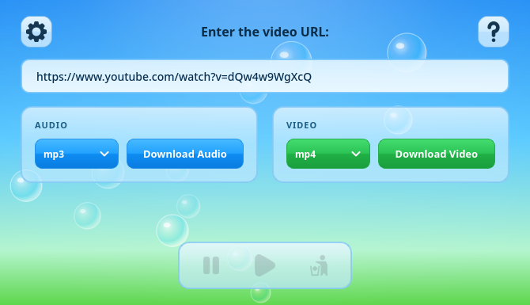
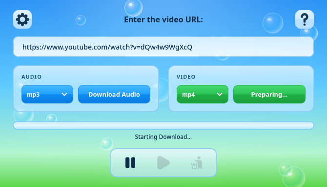
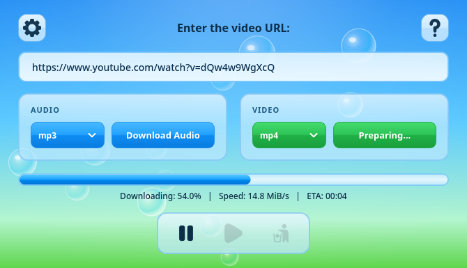
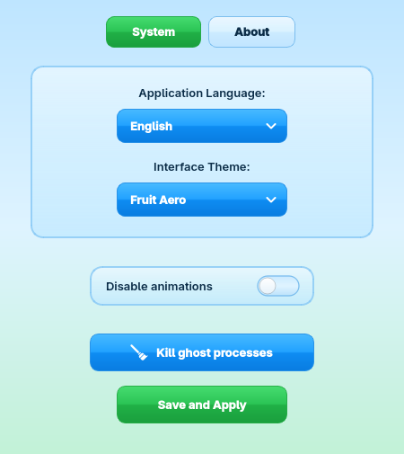
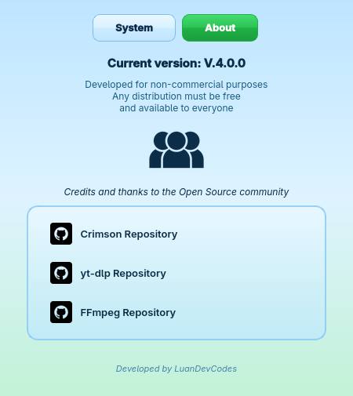
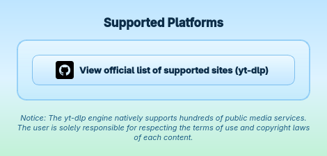

<h1 align="center">
   
  Projeto Crimson - Interface de Download Multi-Plataforma
</h1>

  
  
  
  
  
  

  <a href="../README.md">English</a> &nbsp;|&nbsp; Português (Brasil)

## = Descrição do Projeto
O Crimson é uma aplicação desenvolvida em Python com uma interface gráfica moderna (PySide6 / Qt6) criada para facilitar e automatizar o arquivamento e download de vídeos e áudios em múltiplos ambientes de desktop. O projeto encapsula o poder da biblioteca `yt-dlp` e a capacidade de processamento de mídia do `FFmpeg` por trás de uma tela amigável, elegante e com anti-aliasing nativo no Windows e Linux. A aplicação também gerencia de forma autônoma as atualizações e integridade do seu motor interno para manter compatibilidade contínua com protocolos modernos de mídia. A ideia do projeto nasceu de uma necessidade pessoal de estudo e preservação offline de conteúdo.

## Δ Bibliotecas e Ferramentas
- **Python 3.x**
- **yt-dlp**: Motor principal responsável por buscar e realizar a extração bruta das mídias.
- **PySide6 (Qt6)**: Interface gráfica com anti-aliasing nativo vetorial, visual uniforme em todas as distribuições Linux e no Windows, estilo Fusion e cards modulares responsivos.
- **Threading**: Módulo responsável por criar rotinas em segundo plano, evitando o congelamento da interface gráfica durante o processo de download.
- **json & os & platform**: Orquestradas em conjunto para lidar com a pasta oficial de configurações do usuário (adaptada por sistema operacional) e salvar o estado da aplicação via memória persistente.
- **urllib.request & zipfile**: Usados para orquestrar o motor modular com streaming em blocos e timeout de segurança, agindo como ponte de download direto com a source master do `yt-dlp`.
- **subprocess & re**: Utilizados para operar ferramentas (como limpar processos fantasmas) e tratar os dados de progresso e velocidade com expressões regulares pré-compiladas.
- **webbrowser**: Módulo nativo do Python usado para transformar os links dos repositórios no Painel de Créditos em botões clicáveis de redirecionamento.
- **Pillow (PIL)**: Manipulação avançada de canais RGBA com cache inteligente em memória RAM para desempenho instantâneo.

## § Funcionalidades
- **Download Flexível e Descomplicado**: Escolha entre baixar apenas áudio ou vídeo (com as qualidades mescladas perfeitamente) através de dropdowns visuais (`mp3`, `mp4`, `mkv`, `webm`, etc).
- **Processamento Assíncrono (Zero-Freeze)**: As operações de download pesado e gravação de arquivos não disputam espaço com a renderização visual. Tudo ocorre em *threads* separadas, com a barra de progresso, velocidade e ETA atualizando de forma lisa e constante na thread principal.
- **Download reformulado**: Implementação de uma divisão inteligente de rede. O sistema divide a requisição da mídia em blocos (`http_chunk_size`) com 5 conexões simultâneas, garantindo estabilidade e alto desempenho nas taxas de transferência.
- **Blindagem do Auto-Update Silencioso**: Na inicialização, a thread secundária verifica, valida a integridade estrutural do arquivo ZIP (com proteção contra *path traversal*) e aplica silenciosamente o motor `yt-dlp` com timeout de proteção para conexões lentas ou offline.
- **Conversão por Fator Externo (FFmpeg)**: O motor de extração puxa nativamente os vídeos na melhor qualidade, mas geralmente separadamente da faixa de áudio de alta resolução. O Crimson aciona o FFmpeg de maneira integrada para mesclar essas duas camadas ou convertê-las para formatos específicos.
- **Internacionalização Completa em Tempo Real (25 Idiomas Nativos)**: Suporte integral a 25 idiomas organizados em ordem alfabética (Árabe, Bambara, Bengali, Chinês, Holandês, Inglês, Filipino, Francês, Alemão, Hauçá, Hindi, Indonésio, Italiano, Japonês, Coreano, Latim, Norueguês, Persa, Polonês, Português, Russo, Espanhol, Turco, Ucraniano e Vietnamita). A troca é instantânea pelo Painel de Configurações, sem necessidade de reiniciar.
- **Identidade Visual e 6 Temas Dinâmicos**: O aplicativo suporta variações completas de tema com paletas harmoniosas: `Frutiger Aero` (tema principal com bolhas animadas e vidro Aqua 3D), `Dark` (escuro moderno), `Egg` (creme aconchegante), `Matcha` (verde suave), `Savage` (vermelho vivo e carmesim puro) e `Platinum Disc` (cinza titânio metálico), além de contar com um interruptor (switch) dedicado para desativar animações quando desejado.
- **Eficiência Extrema para Computadores Modestos**:
  - *Cache em RAM de Ícones*: O disco só é lido uma única vez; acessos subsequentes ocorrem em microssegundos direto da memória.
  - *Throttling de Progresso (~16 FPS / 60ms)*: Reduz em ~85% a sobrecarga de repaints na thread de interface durante conexões velozes.
  - *Coleta Ativa de Memória*: Chamadas explícitas de liberação de memória (`gc.collect`) ao pausar, cancelar, finalizar downloads e na limpeza de processos.
- **Persistência de Dados e Roteamento Seguro**: O aplicativo memoriza as preferências do usuário salvando um `.json` seguro na pasta de configurações do sistema. No Windows usa `%LOCALAPPDATA%`, no Linux segue o padrão XDG (`~/.local/share/Crimson`).
- **Janela Centralizada no Monitor Principal**: A posição de abertura da janela é calculada matematicamente com base nas dimensões reais da tela, garantindo centralização mesmo em setups multi-monitor.
- **Gestão de Processos**: Um botão nativo no painel de configurações capaz de "varrer" e finalizar processos órfãos em segundo plano (como threads residuais do FFmpeg), adaptado por sistema operacional (`taskkill` no Windows, `pkill` no Linux).
- **Controle de Instâncias (Anti-Spam)**: As janelas do sistema (como as Plataformas e Configurações) possuem um bloqueio inteligente e modal que impede a abertura simultânea de dezenas de abas ao clicar repetidas vezes.
- **Menu de Contexto Intuitivo**: Interaja com a barra de pesquisa usando o botão direito do mouse para *Colar* links ou *Apagar* seleções de texto de forma rápida.

## ಄ Idiomas Suportados (25 Idiomas Nativos)

| Idioma | Código | Status |
|---|---|---|
| العربية (Árabe) | `Arabic` | [✓] Completo |
| Bamanankan (Bambara) | `Bambara` | [✓] Completo |
| বাংলা (Bengali) | `Bengali` | [✓] Completo |
| 中文 (Mandarim Simplificado) | `Chinese` | [✓] Completo |
| Nederlands (Holandês) | `Dutch` | [✓] Completo |
| English (Inglês) | `English` | [✓] Completo |
| Filipino / Tagalog | `Filipino` | [✓] Completo |
| Français (Francês) | `French` | [✓] Completo |
| Deutsch (Alemão) | `German` | [✓] Completo |
| Harshen Hausa (Hauçá) | `Hausa` | [✓] Completo |
| हिन्दी (Hindi) | `Hindi` | [✓] Completo |
| Bahasa Indonesia | `Indonesian` | [✓] Completo |
| Italiano | `Italian` | [✓] Completo |
| 日本語 (Japonês) | `Japanese` | [✓] Completo |
| 한국어 (Sul Coreano) | `Korean` | [✓] Completo |
| Latina (Latim) | `Latin` | [✓] Completo |
| Norsk (Norueguês) | `Norwegian` | [✓] Completo |
| فارسی (Persa) | `Persian` | [✓] Completo |
| Polski (Polonês) | `Polish` | [✓] Completo |
| Português (Brasil) | `Portuguese` | [✓] Completo |
| Русский (Russo) | `Russian` | [✓] Completo |
| Español (Espanhol) | `Spanish` | [✓] Completo |
| Türkçe (Turco) | `Turkish` | [✓] Completo |
| Українська (Ucraniano) | `Ukrainian` | [✓] Completo |
| Tiếng Việt (Vietnamita) | `Vietnamese` | [✓] Completo |

A troca de idioma é feita em tempo real pelo Painel de Configurações, sem necessidade de reiniciar o aplicativo.

## ദ്ദി( • ᴗ - ) ✧ Sistemas Operacionais Suportados

O Crimson detecta automaticamente o sistema operacional em execução e adapta seu comportamento (caminhos de pasta, localização do FFmpeg, comandos de processo, etc.)

### Windows
| Versão | Status |
|---|---|
| Windows 10 / 11 | [✓] Suporte completo |

### Linux
> [!NOTE]
> No Linux, o `ffmpeg` precisa estar instalado via gerenciador de pacotes da sua distribuição. O PySide6 e demais dependências são instalados no ambiente virtual Python. Consulte o [Guia Linux](../Guides/Guia_Linux.md) para instruções detalhadas.

| Família | Exemplos de Distros | Status |
|---|---|---|
| **Arch Linux** | CachyOS *(testado)*, Manjaro, EndeavourOS, Arch puro | [✓] Suporte completo |
| **Debian / Ubuntu** | Ubuntu, Linux Mint, Pop!\_OS, Zorin OS | [✓] Suporte completo |
| **Fedora / RHEL** | Fedora, AlmaLinux, Rocky Linux | [✓] Suporte completo |
| **openSUSE** | Tumbleweed, Leap | [✓] Suporte completo |
| **Alpine Linux** | Alpine puro | [✓] Suporte completo |

## ❏ Interface Visual

### → Release 3.0.1 (Atual)

  
<b>Visão Geral da Nova Interface (Tema Frutiger Aero - PySide6)</b>

  
  
    
  
  
<b>Download Assíncrono com Atualização em Tempo Real</b>

  
  &nbsp;
  

    

  
<b>Painel de Configurações Dinâmicas e Créditos</b>

  
  &nbsp;
  

    

  
<b>Diálogo de Plataformas Suportadas e Aviso Legal</b>

  

 

## + Guia de Uso e Configuração de Ambiente
Caso você venha a clonar este repositório para inspecionar, executar ou modificar o código através de uma IDE local, existem alguns pré-requisitos fundamentais para o funcionamento.

### Windows
O Crimson não confia na instalação global das dependências no computador do usuário. Ele exige e rastreia o **FFmpeg** em um escopo totalmente local (na mesma pasta do código):

1. **Instale as Bibliotecas**: Instale as bibliotecas com `pip install -r Requirements/requirements_windows.txt`.
2. **Setup do FFmpeg**: Crie uma pasta chamada `ffmpeg` na raiz deste projeto (onde o arquivo `Crimson.py` está localizado).
3. Baixe os binários de execução do FFmpeg (.exe) e aloque-os dentro dessa pasta (ffmpeg.exe, ffplay.exe e ffprobe.exe):
**[ » Acessar Repositório do FFmpeg Builds ](https://github.com/BtbN/FFmpeg-Builds/releases)**

4. Ao rodar o código pela IDE, o Python irá ler o caminho relativo dessa pasta de forma inteligente e injetar temporariamente nas Variáveis de Ambiente (`os.environ["PATH"]`).

### Linux
No Linux, o FFmpeg é instalado pelo sistema, não sendo necessária pasta local. Consulte o **[Guia Linux completo](../Guides/Guia_Linux.md)** para o passo a passo de instalação de dependências, execução e compilação do executável.

## ° Tecnologias Avançadas de Estabilidade e Otimização
O Crimson passou por otimizações no seu núcleo para resolver gargalos de instabilidade de rede, uso excessivo de CPU e bibliotecas estáticas desatualizadas:
- **Compatibilidade Adaptativa de Fluxos**: Com perfis de extração atualizados, o Crimson seleciona automaticamente fluxos de áudio e vídeo de alta definição (1080p e 4K) compatíveis com mesclagem direta via FFmpeg.
- **Uso reduzido de CPU e GPU**: Adoção de PySide6 (Qt6) com renderização nativa Fusion, cache de ícones em RAM, throttling na barra de progresso e pausa automática de animações quando minimizado, economizando cerca de 85% de ciclos da CPU gráfica.
- **Injeção Modular de Motor de Download**: O Crimson baixa e valida a integridade do código-fonte do motor em uma pasta de validação (staging) antes de injetá-lo no caminho de busca do Python (`sys.path.insert`).

## • Arquitetura de Compilação (O Teste de "Releases")
O Crimson nasce não só como uma utilidade do dia a dia, mas também com o papel de ser um **projeto de homologação para o sistema de "Releases" do GitHub**.

A arquitetura final do projeto tem como objetivo compilar (via **PyInstaller**) tanto as lógicas do Python quanto os binários do `FFmpeg` na construção de um único artefato autossuficiente. No Windows, esse artefato é um `.exe` portátil; no Linux, um binário ELF compilado. Esse pacote encapsulado será testado nas publicações de Release do GitHub, servindo como modelo para que qualquer pessoa consiga baixar o software de forma limpa e no melhor conceito "Plug and Play".

---

## ◉ Créditos e Repositórios
Este projeto foi criado com o auxílio de inteligências artificiais (AI), buscando melhoria contínua e novos aprendizados, mas sem omitir seu uso na estruturação e suporte à codificação. 
Além disso, só foi possível graças às excelentes comunidades *Open Source* e aos desenvolvedores e artistas que fornecem ferramentas vitais de forma livre. Meus mais profundos agradecimentos a:

### ◓ Tecnologias Base
- **[yt-dlp](https://github.com/yt-dlp/yt-dlp)**: Motor principal de extração de mídias.
- **[FFmpeg Builds](https://github.com/BtbN/FFmpeg-Builds/releases)**: Processador e conversor integrado de mídia.

### ◒ Design e Ícones (Flaticon)
Os ícones utilizados na interface gráfica pertencem integralmente aos seus respectivos criadores, licenciados para uso gratuito com atribuição através da plataforma **Flaticon**:
- [Ponto de interrogação - ícone criado por Magnific - Flaticon](https://www.flaticon.com/br/icones-gratis/ponto-de-interrogacao)
- [Lixeira - ícone criado por Mayor Icons - Flaticon](https://www.flaticon.com/br/icones-gratis/desperdicio)
- [Continuar - ícone criado por sonnycandra - Flaticon](https://www.flaticon.com/br/icones-gratis/botao-play)
- [Pausar - ícone criado por Slidicon - Flaticon](https://www.flaticon.com/br/icones-gratis/pausa)
- [Configurações - ícone criado por Pixel perfect - Flaticon](https://www.flaticon.com/br/icones-gratis/configuracoes)
- [Comunidade - ícone criado por Soremba - Flaticon](https://www.flaticon.com/br/icones-gratis/comunidade)
- [Github - ícone criado por riajulislam - Flaticon](https://www.flaticon.com/br/icones-gratis/github)
- [Limpeza - ícone criado por Us and Up - Flaticon](https://www.flaticon.com/br/icones-gratis/vassoura)

---

## ! Aviso Legal (Disclaimer)

- **Sem Vínculo Institucional**: O projeto Crimson é uma ferramenta independente de código aberto e não possui qualquer tipo de afiliação, parceria, patrocínio ou endosso por parte de qualquer plataforma ou serviço de mídia.
- **Marcas Registradas**: Todos os nomes de produtos, logotipos, marcas e marcas registradas citados neste projeto pertencem exclusivamente aos seus respectivos proprietários.
- **Responsabilidade do Usuário**: O Crimson é disponibilizado como um cliente de uso geral para arquivamento offline e conversão de mídia. Cabe única e exclusivamente ao usuário certificar-se de que os downloads realizados estão em conformidade com as leis de direitos autorais vigentes em sua jurisdição e com os termos de uso de cada provedor de conteúdo.

---

## ◈ Licença

O projeto **Crimson** é distribuído e licenciado sob os termos da **[GNU General Public License v3.0 (GPLv3)](../LICENSE)**.

Este software é disponibilizado na esperança de que seja útil, mas SEM QUALQUER GARANTIA; sem mesmo a garantia implícita de COMERCIABILIDADE ou ADEQUAÇÃO A UM DETERMINADO PROPÓSITO. Consulte o arquivo [LICENSE](../LICENSE) para obter mais detalhes.

Para consultar as licenças dos componentes e ferramentas de terceiros (FFmpeg, yt-dlp, PySide6, Pillow e Flaticon), veja [THIRD_PARTY_NOTICES.md](../THIRD_PARTY_NOTICES.md).

---

**Desenvolvido por Luan**  
*Ad Infinitum*